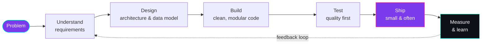
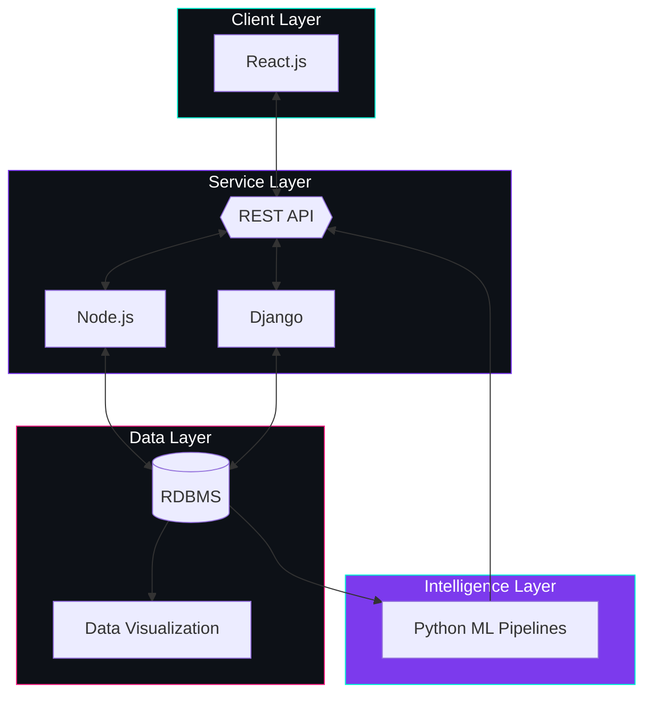

<div align="center">


<a href="https://github.com/khaledhasanmilu">
  
</a>

<br/>

[](https://khaledhasanmilu.pages.dev/)
[](https://www.linkedin.com/in/khaledhasanmilu/)
[](mailto:kh.milu338@gmail.com)


</div>

<br/>

## `~/boot`

```bash
$ ./init --user khaledhasanmilu

[ OK ] Loading identity .............. Khaled Hasan Milu
[ OK ] Mounting education ............ B.Sc. CSE @ United International University
[ OK ] Starting leadership ........... Senior Executive (Event), UIU Robotics
[ OK ] Loading runtime ............... Python | JavaScript | SQL
[ OK ] Starting services ............. React | Node.js | Django | REST
[ OK ] Training in background ........ Machine Learning & AI
[ OK ] Status ........................ Open to internships & collaboration

>> system ready. every day is a learning opportunity.
```

<br/>

## `~/neofetch`

```text
  khaled@milu
  -----------
  OS ............ Curiosity 1.0 (kernel: CSE)
  Host .......... United International University
  Shell ......... Python, JavaScript
  Frameworks .... React, Node.js, Django
  Storage ....... RDBMS (SQL)
  Interfaces .... REST APIs
  Insight ....... Data Visualization
  Training ...... Machine Learning, AI
  Uptime ........ Learning every single day
```

<br/>

## `~/how-i-build`



<br/>

## `~/architecture`



<br/>

## `~/stack`

<div align="center">


</div>

<details>
<summary><b>Data & ML toolkit</b></summary>
<br/>


</details>

<br/>

## `~/engineering-principles`

| # | Principle | In practice |
|:-:|---|---|
| 01 | **Readability is a feature** | Code is read far more than it is written |
| 02 | **Measure, then optimize** | Profile before touching performance |
| 03 | **Small, frequent releases** | Reduce risk, increase feedback |
| 04 | **Quality is built in** | Test early, automate where it counts |
| 05 | **Learn in public** | Write, share, and teach what I learn |

<br/>

## `~/roadmap`

```diff
+ [done]    Core stack: Python, React, Node.js, Django, SQL, REST
+ [done]    Leading events and teams at UIU Robotics
+ [done]    Publishing technical writing and posts
! [now]     Machine Learning & AI, applied end to end
! [now]     Advanced Python patterns and software architecture
! [now]     Software Quality Assurance and test automation
- [next]    Cloud-native deployment and CI/CD (AWS)
- [next]    Production-grade ML systems
- [next]    Bigger open-source contributions
```

<br/>

## `~/telemetry`

<div align="center">


<picture>
  <source media="(prefers-color-scheme: dark)" srcset="https://raw.githubusercontent.com/khaledhasanmilu/khaledhasanmilu/output/github-contribution-grid-snake-dark.svg" />
  <source media="(prefers-color-scheme: light)" srcset="https://raw.githubusercontent.com/khaledhasanmilu/khaledhasanmilu/output/github-contribution-grid-snake.svg" />
  
</picture>

</div>

<br/>

## `~/logs` (writing)

```text
[POST] What is AWS?          -> cloud computing, explained simply
[POST] All About Web 3.0     -> a practical look at the decentralized web
```

[Read: What is AWS?](https://www.linkedin.com/posts/khaledhasanmilu_aws-technology-tech-activity-7244541544978898945-hSct) | [Read: Web 3.0](https://www.linkedin.com/pulse/web30-khaled-hasan-milu-qs3pc)

<br/>

## `~/contact`

```bash
$ ping khaled --purpose "internship | collaboration | open-source"
64 bytes from khaled: time=fast, status=available
```

<div align="center">

<a href="https://khaledhasanmilu.pages.dev/"></a>
<a href="https://www.linkedin.com/in/khaledhasanmilu/"></a>
<a href="https://github.com/khaledhasanmilu"></a>
<a href="mailto:kh.milu338@gmail.com"></a>
<a href="https://x.com/KhMilu338"></a>
<a href="https://codeforces.com/profile/khaledhasan104/"></a>
<a href="https://www.hackerrank.com/profile/kh_milu338/"></a>
<a href="https://www.facebook.com/khaledhasan.milu.581/"></a>
<a href="https://www.instagram.com/khm_milu/"></a>

</div>

<br/>

## `~/motivation`

<!--STARTS_HERE_QUOTE_CARD-->
<p align="center"><sub><code>QUOTE OF THE DAY</code></sub></p>
<h3 align="center"><i>&ldquo;Small commits, big progress.&rdquo;</i></h3>
<p align="center">&mdash; <b>Engineering proverb</b></p>
<!--ENDS_HERE_QUOTE_CARD-->

<br/>

<div align="center">


</div>
